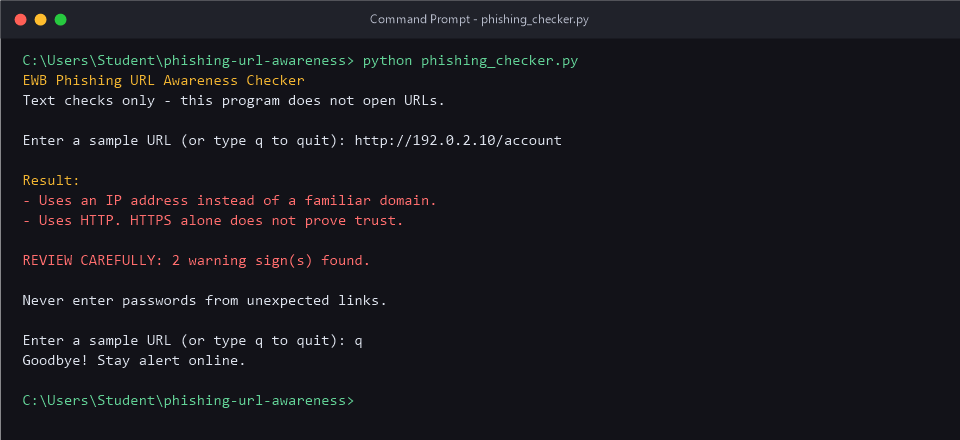
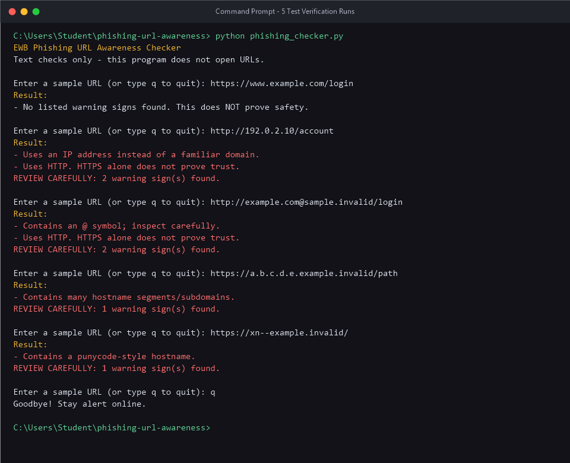

# EWB Phishing URL Awareness Checker

## Overview
Phishing is a deceptive cyber technique where malicious actors construct look-alike links or deceptive messages to trick users into revealing sensitive data, such as login credentials, credit card details, or one-time passwords (OTPs). The EWB Phishing URL Awareness Checker is a lightweight, educational command-line tool written in Python that analyzes URL strings against recognizable structural warning signs. By examining only the raw text of the URL without ever transmitting web requests or visiting destination servers, the tool provides a safe, accessible way to practice defensive URL inspection.

## Features
- Detects an @ symbol in the URL (which can mask destination hosts)
- Flags unusually long URLs (over 100 characters)
- Flags IP-address hostnames (bypassing domain name registration)
- Flags many hostname segments (5 or more parts / subdomains)
- Flags punycode-style hostnames (`xn--`) used in homograph attacks
- Flags the HTTP scheme (lack of transport-layer encryption)
- Interactive session loop with graceful exit commands (`q`, `quit`, `exit`)
- Risk summary alert displaying the total number of flagged indicators
- Defensive error handling to prevent crashes on malformed URLs

## Requirements
Python 3.10 or later. No extra packages needed (uses only Python standard library modules: `re` and `urllib.parse`).

## How to Run
Clone or download the project directory, open your terminal inside the folder, and run:

**Windows:**
```cmd
python phishing_checker.py
```

**Mac/Linux:**
```bash
python3 phishing_checker.py
```

## Example Output
```text
EWB Phishing URL Awareness Checker
Text checks only - this program does not open URLs.

Enter a sample URL (or type q to quit): http://192.0.2.10/account

Result:
- Uses an IP address instead of a familiar domain.
- Uses HTTP. HTTPS alone does not prove trust.

REVIEW CAREFULLY: 2 warning sign(s) found.

Never enter passwords from unexpected links.

Enter a sample URL (or type q to quit): q
Goodbye! Stay alert online.
```

## Testing
The application was evaluated using safe, reserved domain and IP samples. Full details are recorded in `tests/test_samples.md`.

| # | Input | Expected | Actual | Result |
|---|-------|----------|--------|--------|
| 1 | `https://www.example.com/login` | No warning signs | No listed warning signs found. This does NOT prove safety. | PASS |
| 2 | `http://192.0.2.10/account` | IP address + HTTP | Uses an IP address instead of a familiar domain. <br> Uses HTTP. HTTPS alone does not prove trust. | PASS |
| 3 | `http://example.com@sample.invalid/login` | @ symbol + HTTP | Contains an @ symbol; inspect carefully. <br> Uses HTTP. HTTPS alone does not prove trust. | PASS |
| 4 | `https://a.b.c.d.e.example.invalid/path` | Many hostname segments | Contains many hostname segments/subdomains. | PASS |
| 5 | `https://xn--example.invalid/` | Punycode-style hostname | Contains a punycode-style hostname. | PASS |

## Screenshots




## Improvements
1. **Interactive Session Loop with Quit Option**
   - *What changed*: Wrapped the core inspection flow in a `while True` loop that accepts multiple URLs consecutively and gracefully terminates when `q`, `quit`, or `exit` is typed.
   - *Why*: Eliminates the inconvenience of restarting the script for every single URL while keeping execution clean.
   - *How tested*: Tested with rapid succession inputs as well as immediate exit commands and `KeyboardInterrupt` (`Ctrl+C`).

2. **Warning Count Summary Header (`REVIEW CAREFULLY`)**
   - *What changed*: Added a helper function `has_warnings()` and printed an explicit summary (`REVIEW CAREFULLY: X warning sign(s) found.`) when genuine threat indicators are triggered.
   - *Why*: Differentiates normal informational notes (such as empty input or "no warnings found") from actual security red flags, providing quick visual feedback to the user.
   - *How tested*: Verified with single-warning, multi-warning, and clean URL inputs.

3. **Malformed URL Input Protection**
   - *What changed*: Enclosed `urlparse()` inside a `try...except ValueError` block.
   - *Why*: Malformed syntax such as unclosed IPv6 brackets (e.g. `http://[bad`) causes Python's standard `urlparse` to throw an unhandled `ValueError` and crash the program.
   - *How tested*: Passed `http://[bad` as an input and confirmed the program returns `"This text is not a valid URL format."` without terminating.

## Limitations
This is an educational tool. It only reads URL text. It does not visit URLs, scan for malware, or prove that a URL is safe. A URL with zero warnings can still be deceptive or harmful (e.g. typosquatting, freshly registered benign domains, or social engineering pages). "No warning signs found" does NOT mean a URL is safe.

## Ethical Use
Use sample strings only. Do not collect credentials. Do not use this project to deceive anyone or to test websites without permission. Always follow defensive and authorized security learning principles.

## Author
Student, Cybersecurity Course, EWB Courses
